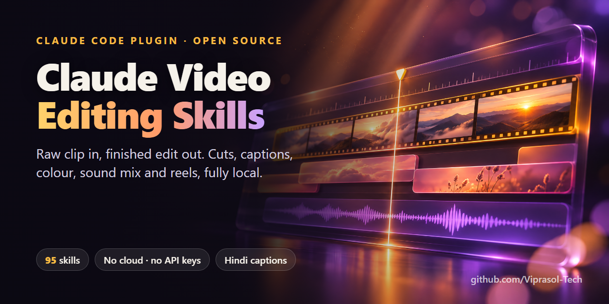
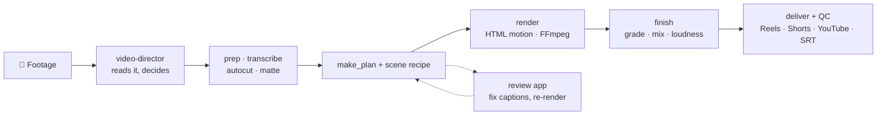

<div align="center">



### A complete, free, local video editor for Claude Code

**Raw clip in → cut, graded, mixed, captioned and delivered edit out.**<br>
No account, no watermark, no credits, no cloud. Hindi / Devanagari ready.

[](https://github.com/Viprasol-Tech/claude-video-editing-skills/stargazers)
[](LICENSE)
[](https://docs.claude.com/en/docs/claude-code)
[](#-whats-inside)
[](https://github.com/Viprasol-Tech/claude-video-editing-skills/actions/workflows/ci.yml)
[](CHANGELOG.md)

`Windows` · `macOS` · `Linux` · runs on a laptop CPU (no GPU needed)

[Quick start](#-quick-start) · [What's inside](#-whats-inside) · [How it works](#-how-it-works) · [Styles](#style-skins-46) · [Genres](#genre-skills-42) · [Catalog](docs/catalog.md) · [Changelog](CHANGELOG.md)

</div>

---

## ✨ Just say what you want

```text
> Edit this video: C:\clips\talk.mp4
> Make a 30 s Instagram reel from podcast.mp4 with the glass-ribbon style
> Cut a wedding highlight from the wedding/ folder on song.mp3, 4 minutes
> These are my shayari lines - put them as captions, keep the song at the end
```

`video-director` watches and listens first (speech, language, faces, music, light, length), picks the genre, style, format and platform, and runs the whole edit through to delivery and QC. You can also name any genre or style yourself.

## 🚀 What's new in v2.2

| | |
| --- | --- |
| 🎞️ **Designed scene sequences** | Styles now change scene every phrase like pro reels: speaker scenes, full-screen type scenes, glass cards, typing search bars, blur transitions. Six recipes: `ribbon`, `aurora`, `retro`, `explainer`, `eclipse`, `layercut`, applied automatically by `run.py`. |
| 🇮🇳 **Hindi / Haryanvi first-class** | Creator profile (language, script, platform), no more Urdu-script captions, `transcribe.py --text` puts *your own* lyrics/shayari on the speech timing, grapheme-safe text animation, Devanagari thumbnails, a `poetry-reel` genre. |
| ⚡ **2.3× faster renders** | Faster overlay capture with frame reuse, same pixels. |
| ✂️ **Cuts that sound professional** | Equal-power crossfades and room tone at every join, VAD silence detection, wind/rumble filter. |
| 🧑‍🎨 **Cleaner cut-outs** | Guided-filter matte edges, steadier masks, edge-contact detection so layouts never show frame edges; blurred or replaced backgrounds with a rim glow. |
| 🖥️ **Local review app** | `python video-studio-core/app/server.py --root <folder>`: watch, fix caption words, switch style, re-render. Bound to 127.0.0.1 with a token. |
| ✅ **Honest QC** | Catches wrong caption script, missing glyphs, text over the face and black frames at the end. |

## 📦 What's inside

| | count | decides | examples |
| --- | ---: | --- | --- |
| 🎬 **Director** | 1 | what the video should be, then runs it | `video-director` |
| ✂️ **Genre skills** | 42 | structure, pacing, cut rules, sound, deliverables | `retention-reel`, `podcast-episode`, `wedding-india`, `music-video` |
| 🎨 **Style skins** | 46 | captions, fonts, graphics, scene recipes | `glass-ribbon`, `glow-cutout`, `poster-pop`, `halo-cut` |
| 🧰 **Utility skills** | 5 | finishing, platform packs, accessibility, NLE hand-off, review rounds | `platform-pack`, `editor-handoff` |
| ⚙️ **Core engine** | 1 | transcription, cuts, timeline, reframe, colour, motion, sound, delivery, QC | `video-studio-core` |

Run any genre with any skin: `wedding-highlight` + `doc-real`, or `retention-reel` + `glass-ribbon`.

## ⚡ Quick start

**Option A: Claude Code plugin**

```bash
claude plugin marketplace add Viprasol-Tech/claude-video-editing-skills
claude plugin install video-studio@claude-video-editing-skills
```

**Option B: installer** (copies every skill to `~/.claude/skills`)

```bash
git clone https://github.com/Viprasol-Tech/claude-video-editing-skills
cd claude-video-editing-skills
powershell -ExecutionPolicy Bypass -File install.ps1   # Windows
bash install.sh                                        # macOS / Linux
```

**Then install the tools once**

```bash
pip install faster-whisper playwright numpy pillow opencv-contrib-python mediapipe fastapi uvicorn fonttools
python -m playwright install chromium
winget install ffmpeg   # Windows  (macOS: brew install ffmpeg · Linux: sudo apt install ffmpeg)
python ~/.claude/skills/video-studio-core/scripts/check_env.py
```

`check_env.py` prints the exact fix for anything missing. Restart Claude Code, then say **"edit this video: path/to/clip.mp4"**.

## 🧠 How it works



| layer | what it decides | examples |
| --- | --- | --- |
| **Director** (the boss) | watches and listens to the footage, picks genre, skin, format, platform and clean-up | `video-director` |
| **Genre skill** (editorial logic) | structure, pacing, cut rules, transitions, sound, loudness, deliverables | `podcast-episode`, `wedding-india`, `trailer-teaser` |
| **Style skin** (the look) | captions, fonts, colours, graphics, scene recipe | `glass-ribbon`, `essay-mode`, `news-desk` |
| **Core** (engine + editor brain) | transcription, cuts, timeline, reframe, colour, motion, sound, delivery, QC | `video-studio-core` |

The editor brain scores cut points with Murch's Rule of Six, sets pacing targets per genre, checks hook and retention beats, keeps overlays inside safe zones and limits caption reading speed, then reviews its own plan (`editor.py review --fix`). These are heuristics: they flag problems, and Claude and you decide.

<details>
<summary><b>Command-line pipeline</b> (what Claude runs for you)</summary>

```bash
python CORE/scripts/run.py clip.mp4 --style SKIN --genre retention-reel --smart-cuts --retakes --work edit-x --stop-after plan
python CORE/scripts/editor.py review edit-x/plan.json --genre retention-reel --fix
python CORE/scripts/render.py edit-x/plan.json --frames 1,4,8,12     # contact sheet: look at it
python CORE/scripts/render.py edit-x/plan.json
python CORE/scripts/finish.py edit-x/plan.json --platform reels
python CORE/scripts/deliver.py edit-x/plan.json --to reels,tiktok,shorts
python CORE/scripts/qc.py edit-x/final.mp4 --plan edit-x/plan.json
```

`CORE` is the `video-studio-core` folder, `SKIN` a style folder such as `~/.claude/skills/glass-ribbon`. `run.py --help` lists every option: `--clips`, `--timeline`, `--auto montage|story|highlights`, `--reframe 9:16`, `--broll DIR`, `--music`, `--platform`, `--deliver youtube,reels`. Hindi lyrics/shayari: `python CORE/scripts/transcribe.py --work edit-x --text lines.txt`. Creator profile: `python CORE/scripts/profile.py show`.

</details>

## Genre skills (42)

Each one has a matching preset: `python CORE/scripts/editor.py genre NAME` shows its pacing, cut rules, captions, loudness and deliverables.

**Short-form**

| skill | what it makes |
| --- | --- |
| `retention-reel` | 15-60 s talking-head reel: hook by 1.5 s, open loop, payoff, loop or CTA |
| `clip-miner-pro` | the 5-15 strongest stand-alone moments from a long recording, reframed 9:16 |
| `reaction-duet` | reaction, duet or stitch: source clip plus facecam, source audio ducked |
| `micro-drama` | binge-able 60-120 s vertical episodes with a recap open and a cliffhanger |
| `gaming-vod` | stream highlights from audio and motion peaks, facecam over gameplay |

**YouTube and long-form**

| skill | what it makes |
| --- | --- |
| `longform-retention` | retention-structured long-form: minute-one promise, re-engagements, quick end |
| `video-essay` | script-first, voice-over-led essay with archival, quote cards, maps and charts |
| `vlog` | a day of A-roll and B-roll as a chronological story |
| `tutorial-screen` | software how-to: promise, numbered steps, recap; waiting cut out |
| `product-review` | verdict tease, specs, macro B-roll, pros and cons, score, disclosure |
| `faceless-explainer` | offline voice-over plus one visual per sentence, no presenter |
| `news-explainer` | inverted-pyramid explainer with attribution on screen |

**Podcast and talks**

| skill | what it makes |
| --- | --- |
| `podcast-episode` | multicam episode switched by who is talking, light filler removal, -16 LUFS |
| `conference-talk` | keynote or panel with title card, slide inserts, trimmed dead air |

**Film and documentary**

| skill | what it makes |
| --- | --- |
| `interview-doc` | paper edit, radio edit, then B-roll over every interview cut |
| `vox-pop` | street interviews: question on screen, answers grouped by intent |
| `scene-editor` | scripted coverage cut by line strings, best performance per line |
| `short-film-finisher` | per-shot colour, mix to delivery loudness, masters after picture lock |
| `trailer-teaser` | three-act trailer with copy cards, risers into hits, button after the title |

**Ads, brand and corporate**

| skill | what it makes |
| --- | --- |
| `ad-ladder` | 60/30 s story master, rebuilt 15 s and 6 s bumper, every ratio |
| `ugc-ad-matrix` | 3-5 hook variants x one body x CTAs, cut native to TikTok and Reels |
| `brand-film` | 2-3 min mission film plus cutdowns, brand-guide lower thirds |
| `testimonial-film` | real customer case study: problem, solution, numbers, recommendation |
| `saas-launch-demo` | 60-180 s launch or demo from a screen recording, cursor zoom, callouts |

**Weddings, events and music**

| skill | what it makes |
| --- | --- |
| `wedding-highlight` | 3-5 min cinematic highlight on the music, vows as the spine, teaser |
| `wedding-india` | multi-day Indian wedding sorted by event, highlight, per-event reels, long film |
| `event-recap` | 60-120 s beat-cut recap with speaker soundbites and a 9:16 version |
| `concert-multicam` | 2-4 angles switched to the music over the board mix |
| `music-video` | performance takes synced to the master, intercut narrative, cut on downbeats |
| `lyric-video` | every lyric line timed to the vocal with a karaoke fill |
| `memorial-tribute` | photo-led chronological life arc, slow and family-approved |

**Lifestyle and how-to**

| skill | what it makes |
| --- | --- |
| `recipe-video` | 30-60 s recipe reel: money shot first, ingredients, sped-up process |
| `fitness-video` | workout reel or follow-along with rep counters and interval timers |
| `fashion-lookbook` | beat-cut lookbook with outfit-change transitions and true-colour grade |
| `travel-cinematic` | music-led travel film with match cuts, whips and speed ramps |
| `real-estate-tour` | walk-through in buyer's-visit order with price, beds and baths cards |
| `course-module` | 3-10 min lesson: one objective, steps, quiz cards, recap, accessible captions |

**Specialist**

| skill | what it makes |
| --- | --- |
| `kids-content` | bright, simple, repetitive, sing-along captions at slow reading speed |
| `asmr-video` | long takes, untouched trigger audio, no music, slow dissolves |
| `regional-devotional` | bhajan, aarti, kirtan and temple films with Indic-script lyrics |
| `localise-dub` | translated subtitles and a time-fitted offline voice-over dub |
| `sports-highlight` | plays from crowd and commentary peaks, freeze-frame spotlight, player card |

## Utility skills (5)

| skill | what it does |
| --- | --- |
| `finishing-pro` | correct, match, look, texture, mix, loudness, legalise, encode, QC on any locked edit |
| `platform-pack` | one master into every platform version, plus captions, chapters and thumbnails |
| `accessibility-pack` | SDH subtitles, clean transcript, audio-description script and described version |
| `editor-handoff` | EDL, FCPXML and OTIO timelines, ProRes 4444 graphics layer, mix WAV for an NLE |
| `versions-review` | numbered versions never overwritten, A/B contact sheets, notes rounds |

## Style skins (46)

Each skin is a folder with `theme.json` and `theme.css`. Pass it as `--style`.

| category | skins |
| --- | --- |
| Talking-head reel (28) | `glow-cutout`† `poster-pop`†* `glass-ribbon`† `neon-marquee`* `grid-stage`†* `halo-cut` `depth-type`* `split-proof` `neon-orbit`* `paper-cut` `chaos-stack` `bold-bounce` `minimal-mono` `frame-studio` `vhs-tape` `y2k-chrome`* `news-desk` `doc-real` `cinematic-phone` `sticker-pop` `terminal-tech` `comic-panel` `swiss-poster`* `soft-gradient` `countdown-list` `before-after` `dual-subs` `hook-lab` |
| YouTube explainer (6) | `editorial-cards` `essay-mode` `whiteboard-host` `chapter-pro` `highlighter-study` `tutorial-steps` |
| Explainer (1) | `data-story` |
| Podcast / repurposing (3) | `clip-miner` `pod-frame` `quote-card-reel` |
| Product / app promo (8) | `device-fly` `kinetic-launch` `ugc-ad-kit` `logo-sting` `testimonial-card` `event-promo` `product-spotlight` `loop-ambient` |

`*` = text sits behind the speaker, `†` = background blurred or replaced around the speaker (both need the person matte). The full list with one-line looks is in [`docs/catalog.md`](docs/catalog.md).

## What the engine does

| area | what you get | script |
| --- | --- | --- |
| Cutting and the brain | pauses, fillers (English and basic Hindi), retakes, cuts at the quietest point, kept breaths, J-cuts at sentence joins; selects and paper edit; story outline, hook candidates, reorder with a constructed-quote warning; Rule-of-Six scoring, pacing, retention, overlay and caption review with safe fixes; 69 genre presets | `autocut.py` `selects.py` `story.py` `editor.py` |
| Timeline | multi-clip assembly with 58 FFmpeg xfade transitions plus dip-black, dip-white and whip; J/L cuts; constant speed and speed ramps; optical-flow slow motion; freeze, reverse, Ken Burns stills; beat-cut montage; frame-exact timing | `timeline.py` |
| Analysis | shot, black, freeze and flash detection; face tracking and active speaker; beats, downbeats and waveform peaks | `scenes.py` `track.py` `beats.py` |
| Reframe | face-follow reframe to any aspect, smooth, fast or locked camera; two-person stacked layout; multicam switching by loudest mic | `track.py` `multicam.py` |
| B-roll | places B-roll from a folder on matching words, covering jump cuts first | `broll.py` |
| Colour | auto correction (white balance, levels, contrast, saturation), approximate log to Rec.709 for 5 cameras, official LUT input, shot matching, 51 looks with skin protection, film texture, scopes and legal levels. Colour is applied to the footage, not to captions and graphics | `color.py` `luts.py` |
| Motion | 45 element types, 34 in/out animation names, 30+ easings, springs, keyframes, 10 text effects, 6 caption presets with safe zones, reading-speed limits and face dodge, 11 transition overlays, beat pulse, face anchoring | `runtime/engine.js` |
| Sound | dialogue chain (high-pass, de-hum, de-click, de-noise, EQ, de-ess, gate, compressor), room-tone fill, 49 synthesized sound effects, speech-aware music ducking, music cut to length on bars, offline voice-over, stems | `audio_chain.py` `music_fit.py` `tts.py` `stems.py` |
| Delivery and QC | 23 platform presets (22 encodes plus a `youtube-hdr` note) with two-pass loudness, reframe and size budgets; SRT, VTT and TTML subtitles to broadcast rules; chapters; thumbnails; post pack; EDL, FCPXML and OTIO; ProRes 4444 overlays; automated QC report | `deliver.py` `captions.py` `export_edl.py` `qc.py` |

Loudness targets per platform: -14 LUFS for social and YouTube, -16 for podcasts, -23 for EBU broadcast, -24 for ATSC and -27 for Netflix (approximate, not dialogue-gated).
Every move, with its exact plan field or flag and an honest Ready / Upgrade / Heavy tag, is in **[docs/catalog.md](docs/catalog.md)**.

## Requirements

- Claude Code (or Cowork on desktop) with skills enabled
- Python 3.10 or newer (tested on 3.14)
- FFmpeg 7, 8 or 9, full build, with `ffprobe` on PATH
- `pip install faster-whisper playwright numpy pillow opencv-contrib-python mediapipe fastapi uvicorn fonttools`, then `python -m playwright install chromium`
- About 500 MB of disk for the first Whisper model (`small`). The person-matte model (~16 MB) downloads on first use.
- Internet only for the first model downloads and Google Fonts. Offline, fallback fonts are used.

## Optional add-ons

None of these are bundled. The engine works without them and uses them when they are installed.

| add-on | for | install | licence |
| --- | --- | --- | --- |
| Kokoro | best offline voice-over | `pip install kokoro soundfile` | Apache-2.0 |
| Piper | alternative voice-over | separate program, called on the command line | GPL-3.0 (run as a separate program only, never imported) |
| rembg | alternative person matte, sometimes cleaner hair | `pip install rembg onnxruntime` | MIT |
| Demucs | split vocals from music | `pip install demucs` (slow on CPU) | MIT |
| librosa | alternative beat tracker | `pip install librosa` | ISC |
| PySceneDetect | alternative shot detection | `pip install scenedetect` | BSD-3 |
| OpenTimelineIO | OTIO through the official library | `pip install opentimelineio` | Apache-2.0 |
| Windows SAPI / macOS `say` / espeak-ng | built-in fallback voices | already on the system | system |

Heavy models are listed by `check_env.py` for reference only. Some are **personal-use, non-commercial** models: they are optional, never bundled, and never downloaded by this pack.

| model | for | licence note |
| --- | --- | --- |
| ProPainter | object removal | non-commercial (S-Lab), needs a large GPU |
| XTTS-v2 / F5-TTS | voice cloning | non-commercial weights; personal use only, and only with the speaker's consent |
| MusicGen | music generation | CC-BY-NC weights; personal use only |
| Real-ESRGAN / RIFE | upscale / frame interpolation | BSD-3 / MIT |

Check each upstream licence yourself before you install it.

## Make your own style

1. Copy any skin folder, for example `halo-cut`, and rename it. The folder name must equal `name:` in its `SKILL.md`.
2. Edit `theme.json`. It holds the format, fonts, CSS variables, speaker layout, the `auto` rules (captions, keywords, headlines, numbers, lists, hook, end card, cut sounds) and `finish`.
3. Edit `theme.css` to style the elements (`.cap-preset-*`, `.card`, `.lowerthird`, `.chip` and so on).
4. For the look, set `finish.grade` to any of the 52 look names (for example `portra` or `teal-orange-pro`). It is applied to the footage, not to your graphics.
5. Test it with `run.py clip.mp4 --style YOUR-SKIN --stop-after plan`, then `render.py plan.json --frames 1,4,8,12`.

References: `video-studio-core/references/theme-schema.md`, `plan-schema.md` and `motion.md`.

## Make your own genre

1. Add a preset to `video-studio-core/scripts/genres.json` under `genres`. Copy the closest one and change the aspect, duration, autocut rules, ASL range, captions, music, SFX density, allowed transitions, hook rules, structure beats, loudness and safe zone.
2. Check it: `python CORE/scripts/editor.py genre YOUR-GENRE`.
3. Make a skill folder with a `SKILL.md` (front matter `name:` = folder name, plus a `description:` that says when to use it). Write how a pro cuts this kind of video: structure, pacing, cut rules, sound, colour, deliverables, common mistakes, and the exact `run.py ... --genre YOUR-GENRE` commands. Use any existing genre skill as the template.
4. `autocut.py`, `make_plan.py`, `editor.py review` and `story.py` all read `--genre`.

References: `video-studio-core/references/craft.md`, `timeline.md`, `color.md`, `audio.md` and `delivery.md`.

## Limits (honest)

- **Limited real-footage testing.** Tested on generated clips and on real low-resolution phone footage (Hindi/Haryanvi). Face tracking, the person matte and skin protection have not been tested on a wide range of faces, skin tones, lighting or profiles. Check every contact sheet.
- **No GPU features by default.** Object removal, upscaling, AI frame interpolation, depth effects and generative video are not included. Optical-flow slow motion uses FFmpeg `minterpolate`, which is slow and can warp complex motion.
- **No lip-sync** and no voice cloning. Dubs are voice-over style, with synthetic offline voices.
- **Log to Rec.709 LUTs are approximate.** They are generated from published curve and gamut formulas, not from manufacturer data. Use the official camera LUT (`color.lut`) when you have one.
- **Skin protection is hue-range based** inside the LUT, not a face mask.
- Face detection misses faces smaller than about 5% of the frame width and profile faces. With no face, the reframe centre-crops.
- Multicam switching does not sync cameras by waveform; every file must start at the same moment.
- Netflix loudness is measured on the full programme, not dialogue-gated. SCC captions are not produced (there is no free CEA-608 encoder). HDR deliveries are not produced.
- Automated QC is a set of heuristics: average-luma flash detection, stream-timing A/V sync and box-based safe zones. It does not replace a watch-down.
- Translation, chapter titles, post copy and audio-description scripts are drafted by Claude from the transcript and the picture. Check them.
- Use only music, footage, fonts and reviews you have the rights to. `testimonial-card` and `testimonial-film` are for real customers and real words only.

## 🎁 More free Claude Code plugins from Viprasol

Get them all with one marketplace:

```bash
claude plugin marketplace add Viprasol-Tech/claude-plugins
claude plugin install <plugin>@viprasol
```

| Plugin | For |
| --- | --- |
| [`trading-studio`](https://github.com/Viprasol-Tech/claude-trading-skills) | Pine Script v6, MQL5 Expert Advisors, backtest audits, position sizing |
| [`tradingview-automation`](https://github.com/Viprasol-Tech/claude-tradingview-automation-skills) | TradingView alerts to real orders: webhooks, Zerodha / Angel One, Binance, MT5 |
| [`options-desk`](https://github.com/Viprasol-Tech/claude-options-trading-skills) | options software: Greeks and IV, spread payoffs and orders, NSE F&O rules |
| [`prop-firm-guard`](https://github.com/Viprasol-Tech/claude-prop-firm-skills) | prop-firm rules: FTMO/Topstep drawdowns, challenge odds, MT5 equity guard |
| [`market-data`](https://github.com/Viprasol-Tech/claude-market-data-skills) | market data you can trust: adjustments, quality checks, bars, calendars |
| [`crypto-bots`](https://github.com/Viprasol-Tech/claude-crypto-bot-skills) | exchange bots: signing, order precision, order books, liquidation maths |
| [`fintech-studio`](https://github.com/Viprasol-Tech/claude-fintech-skills) | payments, ledgers, webhooks, reconciliation, PCI DSS, KYC/AML |
| [`india-stack`](https://github.com/Viprasol-Tech/claude-india-stack-skills) | UPI, GST, Aadhaar eKYC, Account Aggregator, DPDP |
| [`voice-agents`](https://github.com/Viprasol-Tech/claude-voice-agent-skills) | AI phone agents: telephony, latency, testing, compliance |

## 🤝 Contributing

New styles, genres, scene recipes, fixes and docs are welcome. Read [CONTRIBUTING.md](CONTRIBUTING.md), run `python tests/validate_repo.py`, and open a pull request. Questions and show-and-tell go to [Discussions](https://github.com/Viprasol-Tech/claude-video-editing-skills/discussions); bugs and requests use the [issue forms](https://github.com/Viprasol-Tech/claude-video-editing-skills/issues/new/choose).

## Licence

MIT. See [`LICENSE`](LICENSE). Optional add-ons and models keep their own licences.
See [`CHANGELOG.md`](CHANGELOG.md) for what changed.

---

<div align="center">

**If this saves you editing time, please ⭐ the repo** - it helps other creators find it.

Made by [Viprasol](https://github.com/Viprasol-Tech) · Issues and pull requests welcome

</div>
